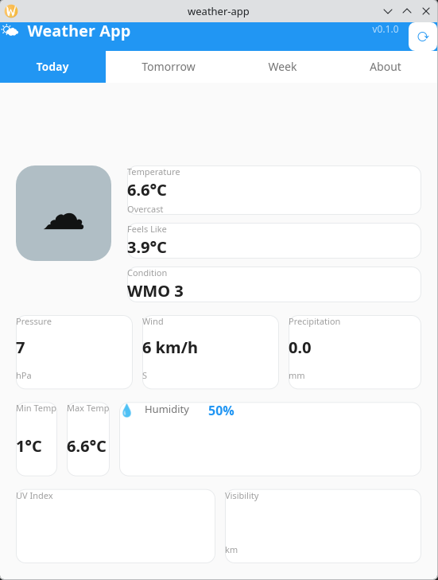
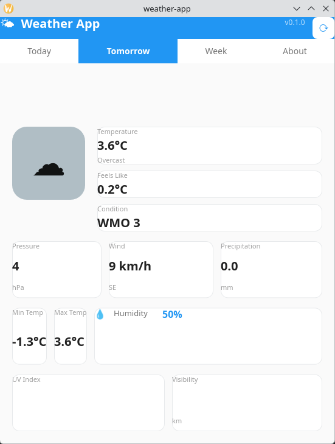
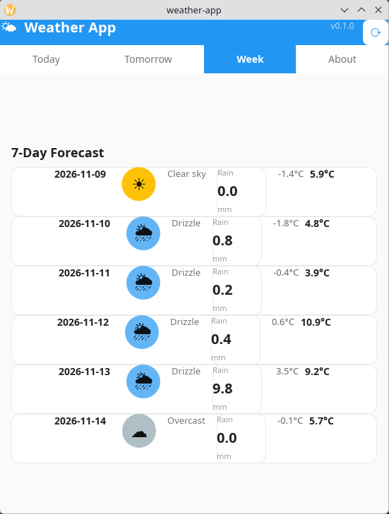
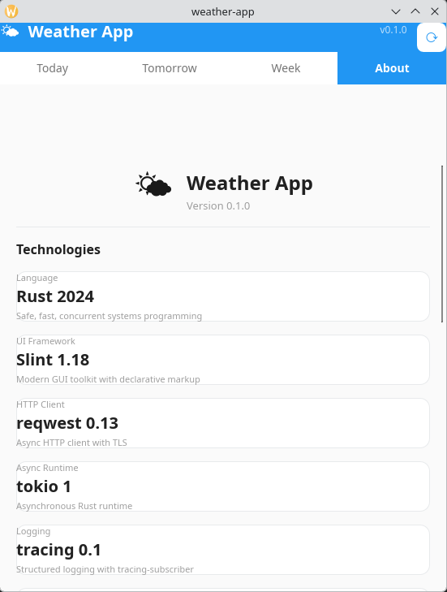

# AetherCast

> A native desktop weather application with a clean, modern interface and resilient multi-provider API fallback.

[](https://www.rust-lang.org/)
[](https://slint.dev/)
[](LICENSE)

---

## What is AetherCast?

AetherCast (from *aether* — the clear upper sky) is a lightweight desktop weather app that fetches real-time conditions from any of six public weather APIs and displays them in a polished tabbed interface. If the primary provider is unreachable, it gracefully falls back through the chain — and always has a mock provider as a last resort. No provider? No problem.

### Features

- **Today & Tomorrow** — temperature, feels-like, pressure, wind, humidity, UV index, visibility, precipitation
- **7-Day Forecast** — scrollable list of daily cards with min/max temps and conditions
- **About** — tech stack, data providers, credits
- **Multi-provider resilience** — Open-Meteo, wttr.in, OpenWeatherMap, WeatherAPI.com, Visual Crossing, plus offline mock
- **Configurable** — city coordinates, preferred provider, log level — all in a TOML config file
- **Structured logging** — console + file via `tracing` + `tracing-subscriber`
- **Native & fast** — single static binary, no webview, no Electron

### Stack

| Layer | Technology |
|-------|------------|
| Language | Rust 2024 |
| UI Framework | [Slint 1.18](https://slint.dev/) (Material renderer) |
| HTTP Client | [reqwest 0.13](https://crates.io/crates/reqwest) (rustls) |
| Async Runtime | [tokio 1](https://crates.io/crates/tokio) |
| Config | [toml 1](https://crates.io/crates/toml) + [dirs 7](https://crates.io/crates/dirs) |
| Logging | [tracing](https://crates.io/crates/tracing) + [tracing-subscriber](https://crates.io/crates/tracing-subscriber) |
| Date/Time | [chrono 0.4](https://crates.io/crates/chrono) |

---

## Screenshots

### Today & Tomorrow




### 7-Day Forecast



### About



---

## Getting Started

### Prerequisites

- **Rust** — 1.80+ (edition 2024)
- **pkg-config** — for build dependencies
- **OpenSSL dev headers** — if using the `native-tls` feature (not needed with default `rustls`)

### Clone & Build

```bash
git clone https://github.com/YOUR-USERNAME/aetheris.git
cd aetheris
cargo build
```

### Run

```bash
cargo run
```

The app opens a native window (~550×700 px) with today's weather. Click the ↻ button in the header to refresh.

### Configuration

On first run, AetherCast creates `~/.config/AetherCast/config.toml`:

```toml
[app]
name = "AetherCast"
version = "0.1.0"

[location]
city = "Warsaw"
latitude = 52.2297
longitude = 21.0122

[weather]
provider = "open_meteo"        # open_meteo | wttr_in | open_weather_map | weather_api | visual_crossing
temperature_unit = "celsius"
wind_unit = "kmh"

[logging]
level = "info"                 # debug | info | warn | error
file = "~/.local/share/AetherCast/app.log"
```

For API-key providers (OpenWeatherMap, WeatherAPI.com, Visual Crossing), set the corresponding environment variable:

| Provider | Environment Variable |
|----------|---------------------|
| OpenWeatherMap | `OPENWEATHERMAP_API_KEY` |
| WeatherAPI.com | `WEATHERAPI_KEY` |
| Visual Crossing | `VISUALCROSSING_API_KEY` |

---

## Building a Release Binary

```bash
cargo build --release
./target/release/aetheris
```

The release build produces a statically linked binary with no runtime dependencies.

---

## How It Works

```
┌──────────────────────────────────────────────────────┐
│  UI Layer (Slint .slint files)                       │
│  ┌────────┬──────────┬──────────┬─────────────────┐  │
│  │ Today  │ Tomorrow │ Week     │ About           │  │
│  └────────┴──────────┴──────────┴─────────────────┘  │
├──────────────────────────────────────────────────────┤
│  Business Logic (Rust modules)                       │
│  Provider chain → fetch → parse → normalise         │
├──────────────────────────────────────────────────────┤
│  Data Providers (6 APIs + mock)                      │
│  Try in config order → fallback → mock              │
└──────────────────────────────────────────────────────┘
```

The provider chain in `main.rs` builds a list of configured providers, adds reliable free ones (Open-Meteo, wttr.in) as fallbacks, and always appends the mock provider last. Each failed attempt logs a warning and continues — the app never crashes due to a missing API key or network issue.

---

## Project Origins

AetherCast was scaffolded and developed using **PolyStrata** ([simplexai-labs/PolyStrata](https://github.com/simplexai-labs/PolyStrata)) with **Qwen3.6-35B-A3B** as the primary coding agent, running inside **OpenCode**. Development leveraged OpenCode's ecosystem of skills (including `rust-incremental` for safe, iterative Rust development) and MCP servers (Rust Analyzer for semantic code navigation, Context7 for up-to-date library documentation) to maintain a correct and compilable codebase throughout.

---

## License

MIT — see the [LICENSE](LICENSE) file for details.
